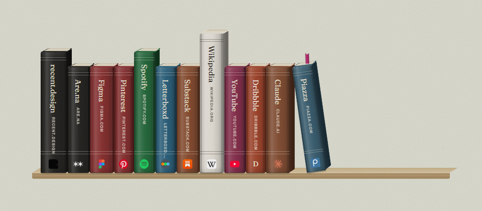
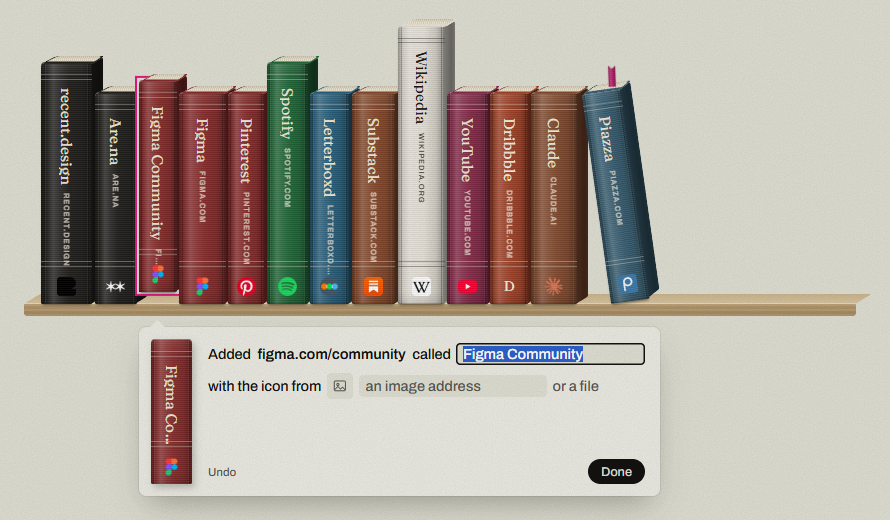
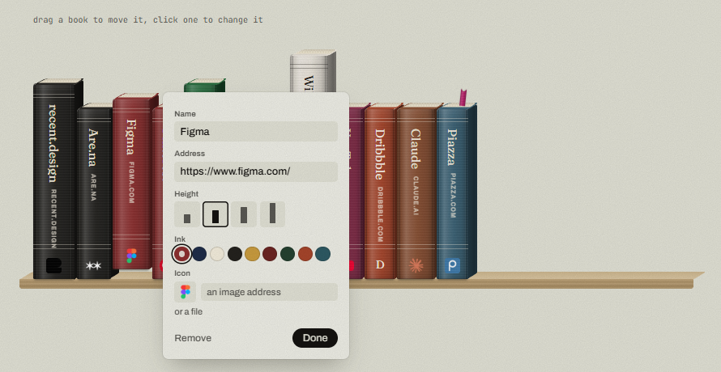
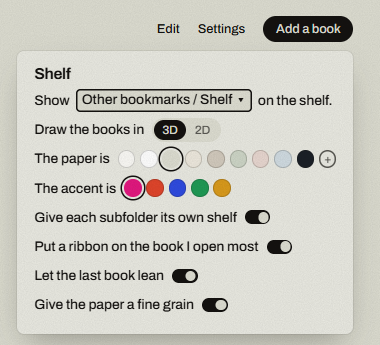
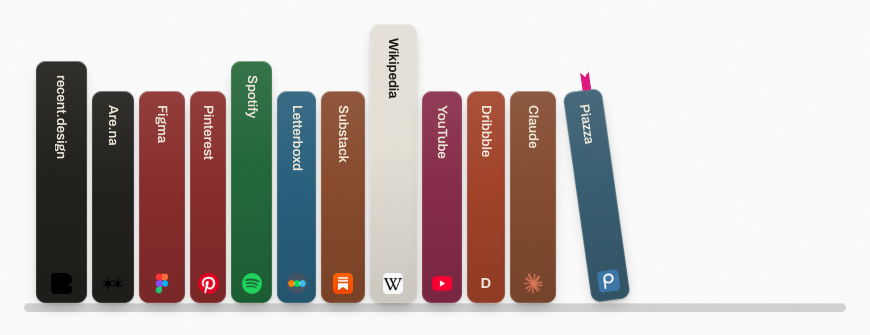

# Shelf

Shelf turns Chrome's new tab page into a bookshelf, where every link is a book with its cover dyed from the site's icon. The books live in their own bookmark folder, so your bookmarks bar stays the way it is. The putty paper is sampled from Shopify Editions and the spines are after Grokipedia's shelf.

## Main features

- Every link is a book, coloured from its site's icon
- Drag any link onto the shelf to add it
- A 3D shelf with cloth spines, or a flat 2D one
- Nine papers (or any colour) and five accents
- A ribbon on the site you open the most

## Install

It isn't on the Chrome Web Store, so it gets loaded as an unpacked extension.

1. Download this repo with **Code** > **Download ZIP** and unzip it somewhere it can stay, because Chrome reads it from that folder every time (mine sits in `C:\dev\personal\shelf-newtab`).
2. In `chrome://extensions` there's a **Developer mode** toggle in the top right corner, turn that on.
3. Then click **Load unpacked** and pick the unzipped folder.
4. Open a new tab and the shelf should be there. The first time, Chrome asks if you meant to change your new tab page, just keep it.

Edge, Brave and Arc load it the same way. The extension ID is fixed in the manifest, so if you load it on a second computer your book heights and colours carry over through Chrome sync.

## How to use it

1. To add a book, drag the little icon at the left of the address bar straight onto the shelf, or a link from any page, or something off the bookmarks bar. The pink line is where it goes, and when you let go a card opens under it where you can rename the book or paste in a different icon. If you have the address but nothing to drag, **Add a book** in the top right lets you paste it in.

   

2. Clicking a book opens it, and so does pressing its number from `1` to `9`, with Ctrl if you want it in a background tab.

3. **Edit** lets you drag books around (which moves the real bookmarks too) and click any book to change its name, address, height, colour or icon. Press **Done** to go back.

   

4. **Settings** is where the 3D and 2D switch is, along with the paper and accent colours and the switches for the ribbon, the leaning last book and the grain.

   

   

## All features

- Its own **Shelf** folder under Other bookmarks, which syncs like any other bookmark folder. You can point it at a different folder in Settings.
- One labelled shelf per subfolder, or all of them together on one shelf
- 3D: hardcover books with page edges on an oak plank
- 2D: flat rounded books on a plain bar, after Apple's newer app icons
- Covers dyed from each site's icon, always dark or light enough for the title to read. Sites Chrome hasn't loaded yet show their first letter until the icon comes in.
- Four heights per book, and your own cover colour if you don't want the icon's
- Drag to add from a page, the address bar, the bookmarks bar or a `.url` shortcut
- **Add a book** for typing or pasting an address
- Icons from a pasted image, a pasted image address, an image dropped on the card or a file
- **Undo** on the card, for a book you just added
- `1` to `9` to open a book, Ctrl for a background tab, Esc to close panels and leave Edit
- A ribbon on the site you opened most this week, once it has at least three visits
- The last book leaning on the others
- Chalk, White, Putty, Linen, Stone, Sage, Blush, Sky and Night papers, or any colour from the picker, with text and panels that adjust to stay readable
- Five accents (Magenta, Vermilion, Cobalt, Green and Ochre) for the ribbon and highlights
- Fine grain on the paper, which you can turn off
- Settings, heights and colours that follow you to other computers through your Chrome account
- No sign-up and no server of its own
